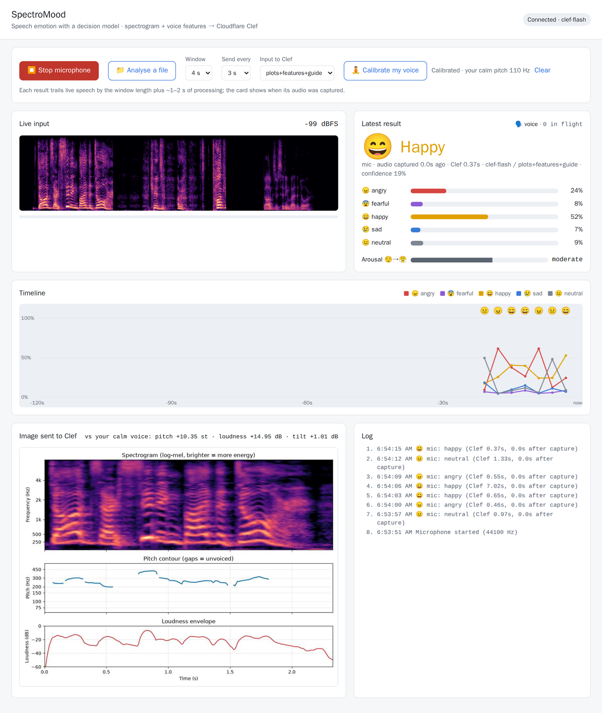
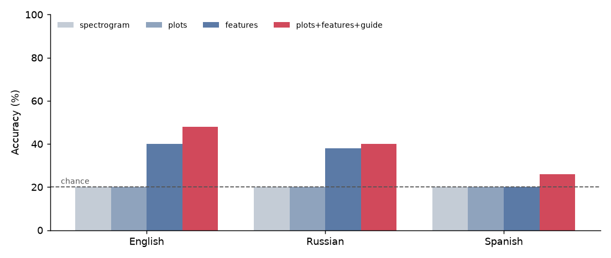
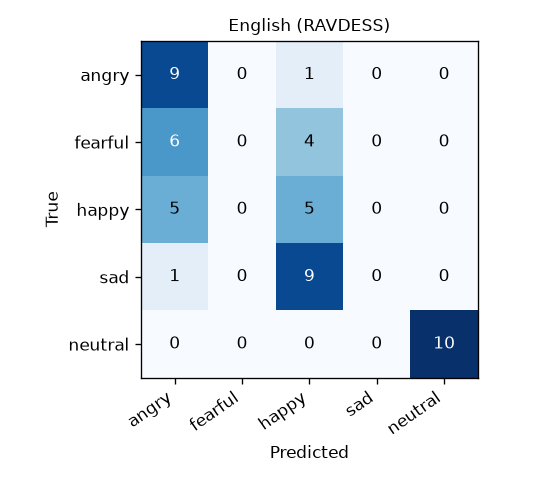
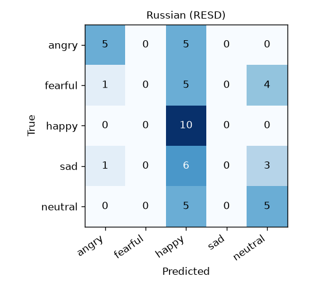
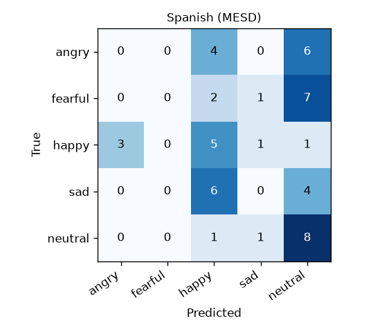
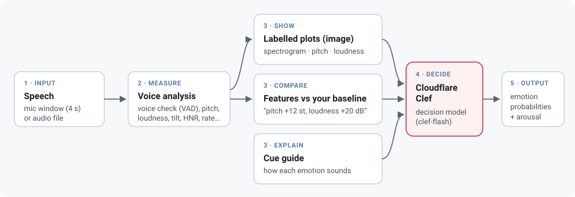
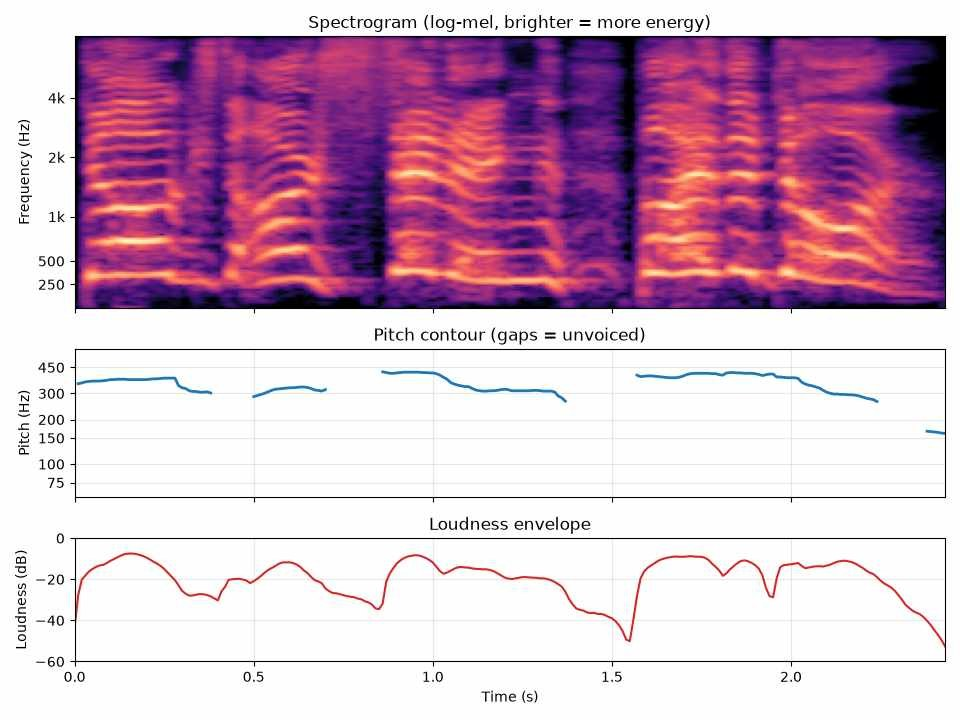

<div align="center">

# SpectroMood

**Speech emotion detection with a decision model.**
Turn a voice into labelled plots and plain-language measurements, then let
[Cloudflare Clef](https://developers.cloudflare.com/workers-ai/models/clef/) decide how the speaker feels.

[](https://github.com/ketul93/spectromood/actions/workflows/ci.yml)
[](LICENSE)




<sub>Dashboard playing benchmark clips through a virtual microphone; results are clef-flash's real answers.</sub>

</div>

SpectroMood is an open experiment: can a general-purpose **decision model**, which was never trained
on audio, recognise emotion in speech if we show it the right evidence? Clef reads a short state,
up to four images and a typed question, and returns a probability for every allowed answer. We give
it a picture of the voice, the speaker's voice measured against their own calm baseline, and a short
guide to how emotions sound, then ask: *angry, fearful, happy, sad or neutral?*

## Results

clef-flash with the recommended `plots+features+guide` setup, 50 clips per language
(10 per emotion: angry, fearful, happy, sad, neutral). **Chance is 20%.**

| language | dataset | speaker baseline | accuracy | macro-F1 | arousal AUC | 😠 angry | 😨 fearful | 😄 happy | 😢 sad | 😐 neutral |
|---|---|---|---|---|---|---|---|---|---|---|
| English | RAVDESS | per speaker | **48%** | 0.39 | 0.93 | 90% | 0% | 50% | 0% | 100% |
| Russian | RESD | corpus average | **40%** | 0.31 | 0.83 | 50% | 0% | 100% | 0% | 50% |
| Spanish | MESD | corpus average | **26%** | 0.16 | 0.66 | 0% | 0% | 50% | 0% | 80% |



What each setup sends to Clef (accuracy):

| setup | image | text | English | Russian | Spanish |
|---|---|---|---|---|---|
| `spectrogram` | log-mel spectrogram | – | 20% | 20% | 20% |
| `plots` | spectrogram + pitch + loudness plots | – | 20% | 20% | 20% |
| `features` | – | voice measurements vs baseline | 40% | 38% | 20% |
| **`plots+features+guide`** | plots | measurements + cue guide | **48%** | **40%** | **26%** |

*Arousal AUC* measures how well the arousal score separates high-energy speech (angry, fearful,
happy) from low-energy speech (sad, neutral): 0.5 is chance, 1.0 perfect. With 50 clips per
language the 95% interval on accuracy is roughly ±14 points. Full tables: [reports/results.md](reports/results.md).

<details>
<summary>Confusion matrices</summary>

  

</details>

## How it works



1. **Gate.** Silero VAD checks each window for a human voice. Windows with only noise, music or typing are
   never sent to Clef, so they cost nothing.
2. **Measure.** A 4-second window is resampled to 16 kHz. pYIN pitch tracking, loudness, spectral
   tilt, harmonics-to-noise ratio, pitch instability, speech rate and pauses are measured.
3. **Show.** The window is drawn as three stacked, labelled panels (spectrogram, pitch contour and
   loudness envelope), because a general vision model reads explicit axes far better than a bare heatmap.
4. **Compare.** Every measurement is restated relative to the same speaker's calm voice ("pitch
   +12 semitones, loudness +20 dB"). Absolute values vary too much between voices to mean anything alone.
5. **Explain.** The answer options describe how each emotion typically changes the voice
   (Banse & Scherer 1996; Juslin & Laukka 2003).
6. **Decide.** Clef returns a probability for each emotion and an arousal score, in about half a second.

<details>
<summary>Example of the image Clef receives</summary>



</details>

## Quick start

You need Docker and a Cloudflare account. Create an API token with **Workers AI** permission
(dashboard → My Profile → API Tokens → "Workers AI" template).

```bash
git clone https://github.com/ketul93/spectromood.git && cd spectromood
cp .env.example .env        # set CLOUDFLARE_ACCOUNT_ID and CLOUDFLARE_API_TOKEN
docker compose up -d --build
```

Open **http://localhost:8000**:

1. Click **🧘 Calibrate my voice** and talk calmly for 6 seconds. This is your baseline. It stays in your
   browser and is sent along with each request.
2. Click **🎙️ Start microphone** and speak. A window is analysed every few seconds, and results appear
   about a second later.
3. Or click **📁 Analyse a file** to run a recording through the same pipeline.

Browsers only allow the microphone on `localhost` or over HTTPS. To use it from another device, put
the container behind HTTPS (for example a Cloudflare Tunnel); file analysis works over plain HTTP.

## Reproduce the benchmark

Everything runs in the `tools` container; nothing needs to be installed locally.

```bash
docker compose run --rm tools python scripts/prepare_data.py --lang en,it,ru,es
docker compose run --rm tools python scripts/evaluate.py --lang en,it,ru,es
docker compose run --rm tools pytest
```

The clip lists in `data/<lang>/` are committed, so every run evaluates the same recordings. Every
Clef answer is cached under a hash of the exact request, so a re-run only pays for new requests.
Results land in [`reports/results.md`](reports/results.md) and the figures in `docs/images/`.

Italian (`--lang it`) is prepared the same way. Evaluating all four languages makes 800 Clef calls
(four setups × 50 clips each), well within one day of the Workers Free allocation.

## What we learned

* **Pictures alone don't work.** With only a spectrogram, or even labelled pitch and loudness plots,
  clef-flash answered "neutral" for every clip in every language (exactly chance). Clef does read the
  images, as a check on panel titles confirmed; it just can't turn them into an emotion judgement.
* **Measurements relative to the speaker are the key.** Stating features against the speaker's own
  calm voice ("pitch +12 st, loudness +20 dB") gave the biggest jump: English went from 20% to 40%.
  Where datasets don't identify speakers (Russian, Spanish), an average corpus baseline is a weaker
  substitute.
* **Arousal is easy; fear and sadness are hard.** Clef reliably tells agitated from calm speech
  (arousal AUC 0.83–0.93) and gets anger and neutral right, but it calls fear and sadness "angry"
  or "happy": in acted speech all three raise pitch and loudness.
* **Bigger isn't better here.** The 27B `clef` model scored lower than the 9B `clef-flash` (it labels
  almost any raised voice "angry"), and `clef-flash` is faster and cheaper, so it is the only model used.
* **Things that did not help** in our experiments: few-shot tables of labelled examples, five yes/no
  questions instead of one choice, a guide contrasting the emotions with each other, and screening
  37 eGeMAPS-style features down to the most discriminative ones. A logistic regression on the same
  measurements reaches 52–66%, so the information is there. A decision model weighing many numbers
  at once is the bottleneck.
* **Words are never used.** The pipeline only sees acoustics, so it is language-independent by
  design. The drop for Spanish reflects that dataset (single spoken words, partly by children, no
  speaker ids) more than the language.

### Next steps

* **Italian** (Emozionalmente, 431 non-professional speakers): the clip list is committed and the
  audio downloads with `prepare_data.py --lang it`, but it has not been evaluated yet. Run
  `evaluate.py --lang it` (200 Clef calls) and send a PR with the numbers.
* **Hindi and Gujarati** are planned via AI4Bharat's
  [Rasa](https://huggingface.co/datasets/ai4bharat/Rasa) (CC BY 4.0, gated, 2 voice artists per
  language). Your own labelled recordings work too: add `data/<lang>/manifest.csv` and
  `baselines.csv` (columns `file,emotion,speaker` and `file,speaker`), put the WAVs in
  `data/<lang>/clips/`, and register the language in `scripts/evaluate.py`.
* A hybrid where a small trained classifier supplies a probability that Clef weighs alongside the
  plots, and real (non-acted) speech.

## Cost and limits

* A request with one image is about 1,800 input tokens. The image itself is about 660 tokens.
* `clef-flash` costs $0.09 per million input tokens at launch prices, roughly $0.0002 per request,
  or about $0.20 per hour of continuous microphone use (one request every 3 s).
* On the Workers **Free** plan the daily allocation (10,000 neurons) covered about 2,300 requests,
  roughly two hours of live use. It resets at 00:00 UTC. When it runs out, the dashboard shows a
  clear error (HTTP 429) instead of failing silently.

## Project layout

```
src/spectromood/   audio prep, features, plots, Clef client, prompts, FastAPI dashboard
scripts/           prepare_data.py (download clips), evaluate.py (benchmark + figures)
data/<lang>/       committed clip lists: manifest.csv, baselines.csv
worker/            optional Cloudflare Worker that proxies Clef via the Workers AI binding
reports/           benchmark results
```

## Datasets and licences

The code is Apache-2.0. The audio is **not** redistributed; `prepare_data.py` downloads it from the
original sources, which keep their own licences:

| language | dataset | licence | speakers |
|---|---|---|---|
| English | [RAVDESS](https://zenodo.org/records/1188976) (Livingstone & Russo, 2018) | CC BY-NC-SA 4.0 | 24 actors |
| Italian | Emozionalmente via [CAMEO](https://huggingface.co/datasets/amu-cai/CAMEO) | CC BY 4.0 | many, non-professional |
| Russian | RESD via CAMEO | MIT | not labelled (corpus baseline) |
| Spanish | MESD via CAMEO | CC BY 4.0 | not labelled (corpus baseline) |

The example images in `docs/images/` are derived from these recordings under the same terms.

## Acknowledgements

Cloudflare for Clef and Workers AI; the authors of RAVDESS, Emozionalmente, RESD, MESD and Rasa;
the CAMEO collection for packaging many emotional speech corpora in one place.

## License

[Apache-2.0](LICENSE)
